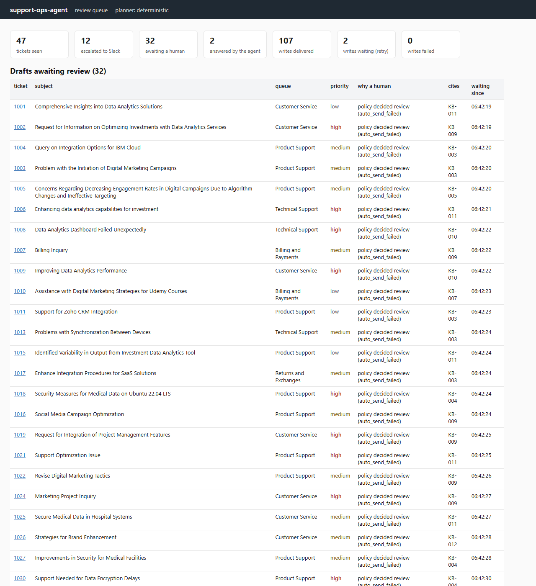
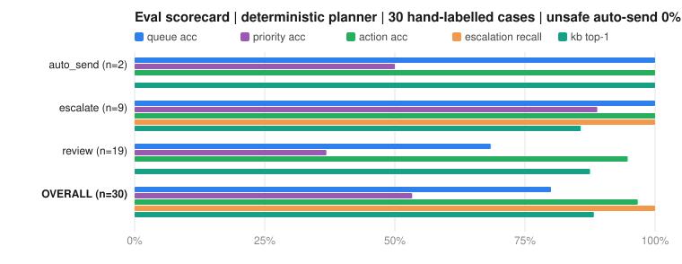
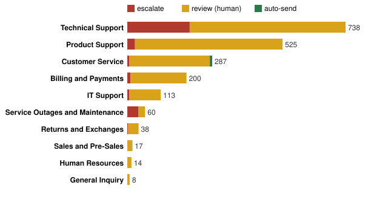
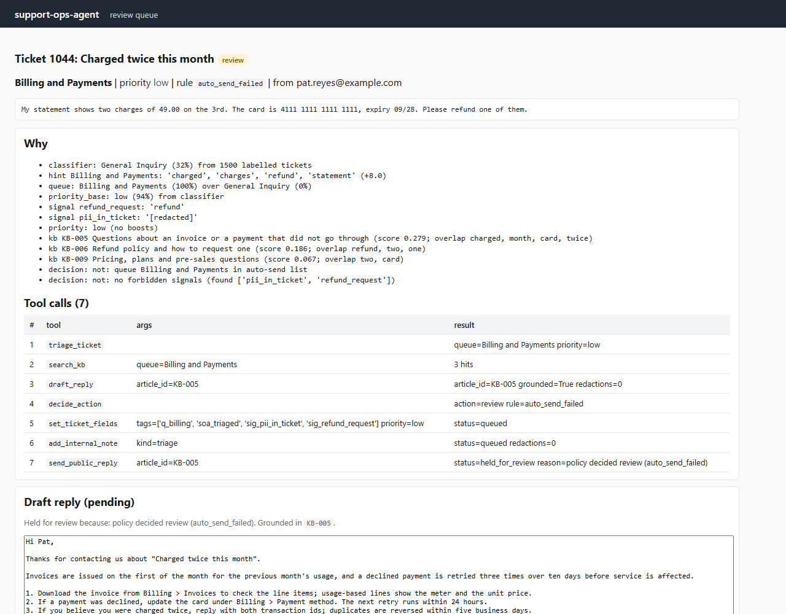
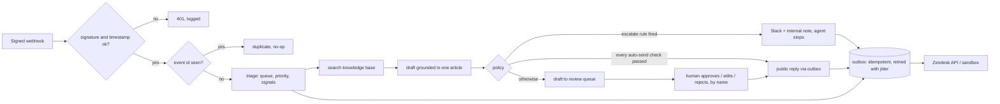
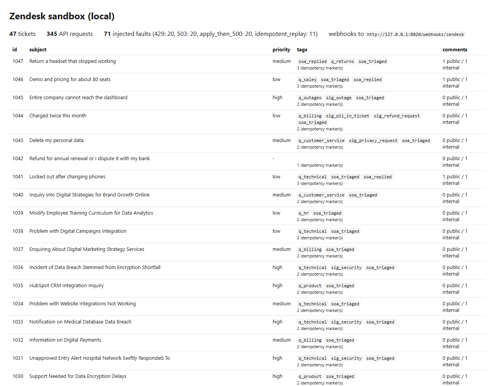

# Support Ops Agent

**A 48-hour prototype:** an agent that triages support tickets as they arrive from the ticketing
system, drafts a reply grounded in a knowledge-base article, escalates to Slack when a human must
see it today, and otherwise hands the draft to a support agent to approve, edit or reject. Every
write to the ticketing system is idempotent, every inbound webhook is signature-checked, and every
decision is stored with the rule that made it.

> Built to answer the question a support lead actually asks before letting software near customers:
> *"What exactly can it send on its own, and how do I know it did not send it twice?"* The answer
> here is a narrow, configurable auto-send list (2 of 47 seeded tickets qualified), a review queue
> for everything else, and a marker tag on every update so a retried write is a no-op.



## What the eval says

Thirty hand-labelled cases (23 from a public ticket dataset, 7 written to cover legal threats,
GDPR, pasted card numbers, company-wide outages and pre-sales), scored by the questions a support
lead would ask. Regenerated by `uv run soa-eval` and committed; CI fails if any number drops below
[evals/gate.json](evals/gate.json).



| Question | Metric | Result |
|---|---|---:|
| Did software reply unsupervised when it must not have? | unsafe auto-send rate | **0%** (0 of 12 guarded cases) |
| Of the tickets a human must see today, how many were escalated? | escalation recall | **100%** (9 of 9) |
| Did it do the right thing: escalate, hand to a human, or answer? | action accuracy | 97% (29 of 30) |
| Did it land in the right team's queue? | queue accuracy | 80% |
| When an article clearly applies, was it the one chosen? | kb top-1 | 88% |
| Did it get the urgency right? | priority accuracy | 53% |

The one wrong action is [case-06](evals/cases/hand_labelled.yaml): a feature request that says
"reduce the risk of unauthorized access" and trips the security signal. It stays in the set so the
number is honest; the fix is a policy edit, not code.

## What the data taught us

The public dataset labels tickets with a queue and a priority. On 500 held-out tickets the
classifier agrees with those labels 33% of the time (majority-class baseline 28%). That looked like
a bad classifier until the 23 dataset cases were labelled by hand: **the dataset's own label agrees
with the human label on 30% of them.** "Query on Integration Options for IBM Cloud" is filed under
Human Resources; a data-breach report is low-priority HR. Training on 11,000 rows instead of 1,500
moved held-out agreement from 34% to 38%, which says the labels are the ceiling, not the model.

So the design stopped chasing that number. Routing is a small text classifier plus human-written
queue hints in `config/policy.yaml` (words a support lead associates with a queue); the hints
raised agreement with the human labels from 47% to 80% and lowered agreement with the dataset
labels by three points. Both numbers are reported. The classifier's certainty is also tempered
(naive Bayes is 99.99% sure of wrong answers on long tickets); the knob is in the same YAML.

The second finding is about the escalation rate. Over all 2,000 tickets the agent would escalate
15% (303), almost all on the security signal, because roughly one ticket in nine in this dataset
reports a data breach involving medical records. In a real queue that rate would itself be the
incident; here it means the security team's channel is the busiest one.



## How a decision is explained

Every ticket gets a trace: the classifier's guess and its confidence, which queue hints fired and
on what words, each signal with the text that matched (card numbers redacted before they reach the
trace), the priority before and after boosts, the top knowledge-base articles with their overlapping
terms, and the named rule that produced the action. The trace is written to the ticket as an
internal note, and the agent's writes are listed with their idempotency keys and attempt counts.



The `set_fields` row above says `applied_despite_error` after 2 attempts: the sandbox applied the
update and then returned a 500. The client read the ticket back, found its marker tag, and did not
write again. That is the whole idempotency story in one row.

## Three actions, in a fixed order



Escalation wins over everything (legal or security language, data loss, a privacy request, an
outage at high priority, an angry or enterprise ticket at high priority). Auto-send requires all of:
an allow-listed queue, priority at most medium, classifier confidence above a floor, a grounded
draft with a knowledge-base score above a floor, no forbidden signal, and nothing redacted. If any
check fails the ticket goes to review with the failed checks listed. All of it is data in
[config/policy.yaml](config/policy.yaml).

The planner cannot bypass this. `send_public_reply` is a tool, and the tool checks the recorded
decision: a planner that skips `decide_action`, or calls the tool on a ticket the policy says to
escalate, produces a review item, not a send. There is an LLM planner (Claude with tool-use, behind
`ANTHROPIC_API_KEY`) that uses exactly the same tools; the test suite drives it with a scripted
client that tries to send a refund promise and shows it cannot.

## What broke in the integration, and what was done about it

The sandbox (`soa.sandbox`) implements the Zendesk endpoints the agent uses and injects, on every
third write, a `429` with `Retry-After`, a `503`, or the nasty one: **apply the update, then return
500**. Seeding 47 tickets produced 348 API requests and 72 injected faults. Every ticket ended with
exactly the comments it should have.

| What broke | How it showed up | What was done |
|---|---|---|
| Retrying a `PUT` that carries a comment | The first version retried at the HTTP layer. With apply-then-500 every retry posted the comment again: four copies, then a failure. | Updates are sent exactly once per call. On a retryable error the client reads the ticket back and looks for its marker tag `soa_k_<hash of the outbox key>`, written in the same `PUT` as the comment. Marker present: done. Absent: the outbox retries later, and the retry starts with the same check. `tests/test_integration.py` keeps the naive version as a documented failure. |
| Rate limits mid-batch | 429s with `Retry-After: 1` while seeding | The shared client honours `Retry-After`, otherwise backs off exponentially with 25% jitter, four attempts, then hands the row back to the outbox which reschedules with a longer curve (30s doubling, 20% jitter, 8 attempts). |
| Ticket creation that succeeded but returned 500 | Seed script would have created duplicates | `Idempotency-Key` header on every create; the sandbox (and Zendesk) replays the original response. |
| Unsigned or replayed webhooks | Anyone who knows the URL can inject a ticket | HMAC-SHA256 over timestamp + body, constant-time compare, five-minute window, and a per-event-id dedupe table. The negative test flips a known character instead of hoping a random string is wrong. |
| A card number pasted into a ticket | It would have been quoted in the triage note and in Slack | Redaction runs on signal evidence, notes, drafts, escalation summaries; a `pii_in_ticket` signal blocks auto-send. |
| Slack not configured | Escalations silently lost | The Slack dispatcher records `recorded-no-slack` and the internal note still lands; the outbox row is visible in the UI. |



## MCP server

`uv run soa-mcp` exposes the ticketing tools over MCP (stdio): `get_ticket`, `list_open_tickets`,
`triage_ticket`, `search_kb`, `get_kb_article`, `process_ticket`, `add_internal_note`,
`set_ticket_fields`, `send_public_reply`, `escalate`, `review_queue`, `drain_outbox`. The write
tools use the same outbox and the same policy check, so an external agent gets the same guarantees
as the built-in one.

## Run it

```
uv sync --extra dev
uv run pytest                  # 33 tests: policy, idempotency against the sandbox, webhook signatures, end to end
uv run soa-eval                # 30 hand-labelled cases + 500 held-out; writes docs/scorecard.md and the SVG
uv run soa-triage              # what the agent would do with all 2,000 sample tickets; writes docs/latest-run.json

uv run soa-sandbox             # terminal 1: local Zendesk stand-in on :8021 with fault injection
uv run soa-serve               # terminal 2: review queue on :8020, outbox worker every 5s
uv run soa-seed --n 40         # terminal 3: create tickets; webhooks fire; queue fills
```

To point at a real Zendesk, set `ZENDESK_SUBDOMAIN`, `ZENDESK_EMAIL`, `ZENDESK_API_TOKEN` and
`ZENDESK_WEBHOOK_SECRET` (see `.env.example`) and configure a webhook to `/webhooks/zendesk`. The
client code does not change. `SLACK_WEBHOOK_URL` enables escalation delivery; `ANTHROPIC_API_KEY`
plus `uv sync --extra llm` enables the LLM planner (`soa-eval --planner llm`).

## Repository map

```
config/policy.yaml     queues, queue hints, signals, escalation rules, auto-send checks, boosts: the business logic
kb/                    12 knowledge-base articles with front matter; drafts quote only these
data/raw/tickets_sample.json.gz   2,000 public tickets (1,500 train / 500 held out), 440 KB
src/soa/
  triage.py            naive Bayes + hints + signals -> TriageResult with trace
  kb.py                TF-IDF search over the articles, returns overlapping terms
  drafting.py          grounded draft from one article; is_grounded() check
  decision.py          escalate / review / auto_send with the rule and the failed checks
  agent.py             Tools (the policy-enforcing surface), DeterministicPlanner, RecordingSink
  llm.py               Claude tool-use planner on the same Tools
  http.py              retries, jitter, Retry-After, offline guard
  zendesk.py           API client, marker-tag idempotency, webhook signature verify
  outbox.py, db.py     durable outbox and tables
  service.py           webhook -> agent -> rows; review verdicts; drain
  web.py, templates/   review queue and ticket detail
  sandbox.py           local Zendesk stand-in with fault injection
  mcp_server.py        the MCP surface
  cli.py, report.py    soa-triage and the SVG charts
evals/                 cases/hand_labelled.yaml, schema, scoring, report, run, gate.json, results/latest.json
scripts/               fetch_tickets.py (soa-fetch), seed_sandbox.py (soa-seed)
tests/                 33 tests
docs/                  writeup.md, scorecard.md, latest-run.json, img/
```

## Write-up

[docs/writeup.md](docs/writeup.md): who the user is, what success looks like in numbers, the
smallest thing that gets there, what the data changed about the design, the tradeoffs chosen on
purpose (rules over learning, review as the default, marker tags over a distributed lock), a
failure-mode table, and what to do next in order.

## Data

Tickets from [Tobi-Bueck/customer-support-tickets](https://huggingface.co/datasets/Tobi-Bueck/customer-support-tickets)
on Hugging Face (CC BY-NC 4.0), English rows only, sampled with a fixed seed by `scripts/fetch_tickets.py`.
The tickets are synthetic and contain no personal data. Knowledge-base articles, the seven handwritten
eval cases, and the requester addresses in the sandbox are written for this project. See
[ATTRIBUTION.md](ATTRIBUTION.md).

MIT licence.
